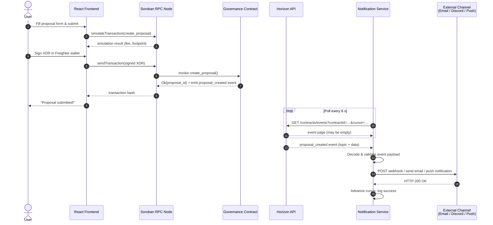
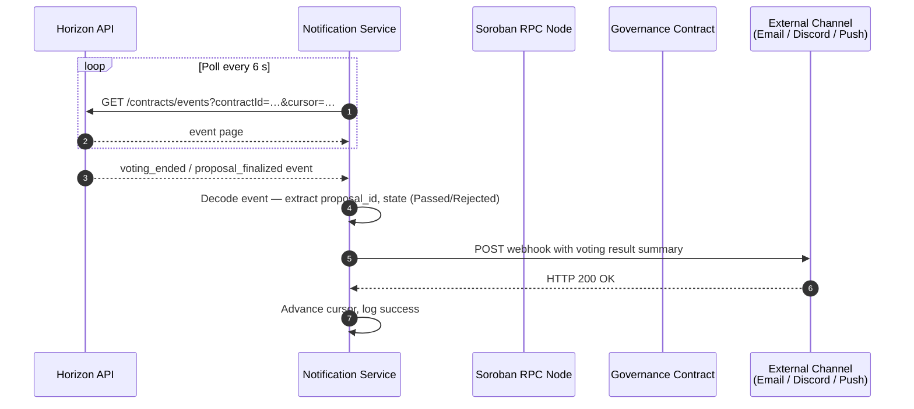
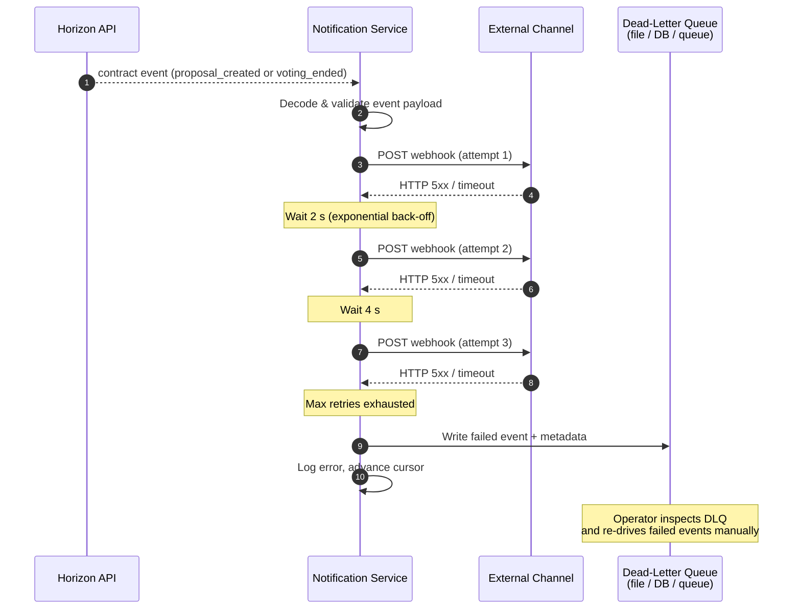

# Architecture: Notification Service & Backend

This document describes how the off-chain backend components interact with each other and with the Stellar/Soroban network.

---

## System Architecture Diagram

```
┌─────────────────────────────────────────────────────────────────────────┐
│                          CosmosVote — Full System                        │
├─────────────────────────────────────────────────────────────────────────┤
│                                                                           │
│   Browser / Wallet (Freighter)                                            │
│   ┌──────────────────────────┐                                            │
│   │  React Frontend (Vite)   │                                            │
│   │  • Proposal browser      │                                            │
│   │  • Vote submission UI    │                                            │
│   └────────────┬─────────────┘                                            │
│                │ HTTPS / JSON-RPC                                          │
│                ▼                                                           │
│   ┌──────────────────────────┐       ┌───────────────────────────────┐   │
│   │   Soroban RPC Node       │       │   Horizon REST API            │   │
│   │  (getTransaction,        │       │  (account info, tx history,   │   │
│   │   simulateTransaction,   │◄──────┤   fee stats, event stream)    │   │
│   │   sendTransaction)       │       └───────────────────────────────┘   │
│   └────────────┬─────────────┘                         ▲                 │
│                │ Soroban events                          │                 │
│                ▼                                         │                 │
│   ┌──────────────────────────┐                          │                 │
│   │  Notification Service    │──────────────────────────┘                 │
│   │  • Polls event stream    │  subscribes to Horizon event stream        │
│   │  • Parses contract events│                                            │
│   │  • Dispatches alerts     │                                            │
│   └────────────┬─────────────┘                                            │
│                │ webhooks / email / push                                   │
│                ▼                                                           │
│   ┌──────────────────────────┐                                            │
│   │  External Channels       │                                            │
│   │  (Email, Discord, etc.)  │                                            │
│   └──────────────────────────┘                                            │
│                                                                           │
│   ┌─────────────────────────────────────────────────────────────────┐    │
│   │                    Soroban Blockchain (Stellar)                   │    │
│   │  ┌──────────────────────────┐   ┌──────────────────────────┐    │    │
│   │  │   Governance Contract    │   │    Token Contract (VOTE) │    │    │
│   │  │  create_proposal         │   │  balance / transfer      │    │    │
│   │  │  cast_vote               │◄──┤  mint / burn             │    │    │
│   │  │  finalise / execute      │   │  SEP-41 compliant        │    │    │
│   │  └──────────────────────────┘   └──────────────────────────┘    │    │
│   └─────────────────────────────────────────────────────────────────┘    │
│                                                                           │
└─────────────────────────────────────────────────────────────────────────┘
```

---

## Component Summary

### React Frontend
The Vite/React app lets users browse proposals, connect their Freighter wallet, and submit votes. It communicates directly with the Soroban RPC node to simulate and send transactions.

### Soroban RPC Node
Provides the JSON-RPC interface for interacting with deployed smart contracts — simulating transactions, sending signed XDR, and fetching ledger entries. Used by both the frontend and the notification service.

### Horizon REST API
Stellar's REST gateway. Used by the notification service to subscribe to the contract event stream and by the frontend for account metadata and fee statistics.

### Notification Service
A lightweight backend that:
1. Subscribes to the Horizon event stream filtered by the governance contract ID.
2. Decodes emitted Soroban events (e.g., `proposal_created`, `vote_cast`, `proposal_finalized`).
3. Dispatches notifications to configured channels (email, Discord webhook, push).

> **Webhook signing:** Every webhook delivery is signed with HMAC-SHA256 using a
> shared secret and carries the signature in the `X-CosmosVote-Signature` header.
> Each delivery also includes a timestamp header so subscribers can reject
> replayed requests. Subscribers must verify the signature before acting on a
> delivery. See
> [`docs/notification-service.md`](./notification-service.md#verifying-webhook-signatures)
> for the verification algorithm, a code example, and the key rotation procedure.

### Smart Contracts (Soroban)
- **Governance Contract** — manages proposals, votes, finalization, and execution.
- **Token Contract (VOTE)** — SEP-41 token; vote weight derived from balance at vote time.

---

## Data Flow: Vote Submission

```
User clicks "Vote Yes"
  → Frontend calls simulateTransaction (Soroban RPC)
  → User signs XDR in Freighter wallet
  → Frontend calls sendTransaction (Soroban RPC)
  → Governance contract emits vote_cast event on-chain
  → Notification service detects event via Horizon stream
  → Notification dispatched to subscribers
```

---

## Sequence Diagrams

The diagrams below show the full event-driven flow of the notification service,
including happy paths and error paths. They render natively in GitHub.

### ProposalCreated — happy path



### VotingEnded — happy path



### Error paths — webhook failure, retry, and dead-letter queue



---

## Related Docs

- [`README.md`](../README.md) — contract-level architecture
- [`docs/lifecycle.md`](./lifecycle.md) — proposal state machine
- [`docs/storage.md`](./storage.md) — on-chain storage layout
- [`docs/notification-service.md`](./notification-service.md) — service configuration
